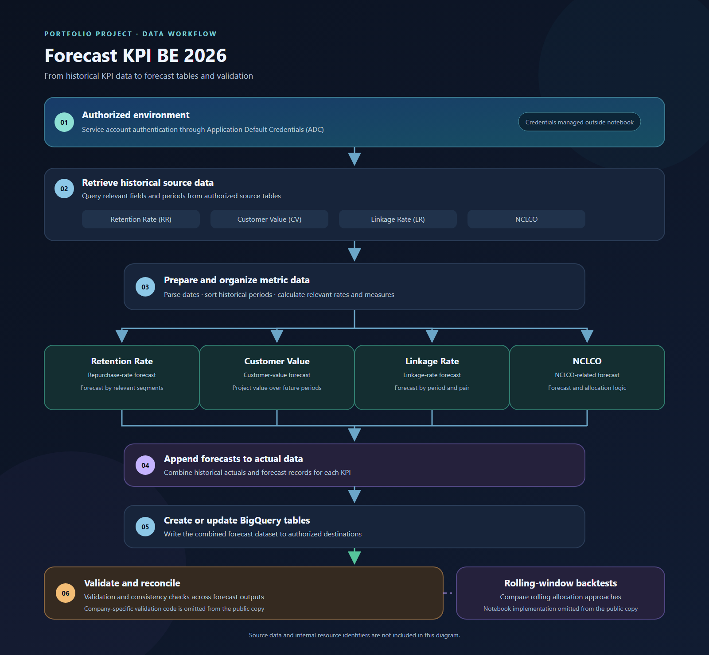

# Forecast KPI BE 2026

A Jupyter notebook demonstrating a KPI forecasting workflow for 2026, from historical source-data retrieval and metric-level forecasts to combining forecasts with actuals and preparing BigQuery outputs.

## Forecast metrics

The notebook covers:

- **Retention Rate (RR):** repurchase-rate forecasting
- **Customer Value (CV):** customer-value forecasting
- **Linkage Rate (LR):** linkage-rate forecasting
- **NCLCO:** source-data retrieval and a high-level description of the forecasting workflow

## Workflow

1. Retrieve relevant historical data for each metric from authorized source tables.
2. Prepare and forecast RR, CV, and LR using metric-specific logic.
3. Combine forecast records with actual data.
4. Prepare forecast outputs for BigQuery.
5. Review validation and rolling-window backtesting approaches described in the notebook.

## BigQuery authentication

BigQuery authentication is intended to use a **service account** configured through Application Default Credentials (ADC) in an authorized environment. The notebook does not include a service-account key or other credentials. Never commit secrets or credential files.

Internal BigQuery project, dataset, and table identifiers have been replaced with generic placeholders. Configure placeholders only with resources you are authorized to access.

## Public-copy scope

Company-specific NCLCO product/channel hierarchies, brand diagnostics, SQL Server connection details, source queries, and database-specific allocation/reconciliation code have been omitted. The notebook explains where those steps fit in the workflow; no dummy or source data is included. To run a complete workflow, implement the omitted data adapters and mappings using approved resources and authorization.

The original source notebook was left unchanged. This portfolio copy has saved cell outputs removed, embedded password values replaced, and internal BigQuery identifiers anonymized. Confirm that you are authorized to publish the remaining notebook content before sharing it publicly.

## Requirements

Run the notebook in a Python/Jupyter environment with its required libraries installed, including pandas, NumPy, and the Google Cloud BigQuery client. Access to BigQuery resources must be granted separately.
